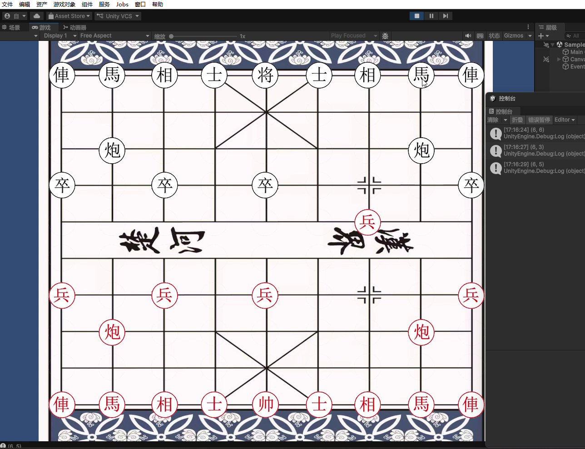

# 中国象棋（Unity / C#）

一个可以完整对弈的中国象棋 Demo，独立开发。核心逻辑约 34KB，采用事件驱动架构。

## 功能

- 车、马、炮、象、士、将 / 帅、兵全棋种走法生成与规则校验
- 蹩马腿、堵象眼、将军 / 将死判定
- 红黑双方轮流对弈、悔棋

## 技术要点

- 事件驱动架构（EventHandler），解耦「选子—移动—吃子」交互
- 单例管理（ChessManager）统一维护棋盘状态（棋盘数组）
- 枚举划分阵营（Camp）与棋子类型（ChessType）

## 演示

## 说明

Unity 项目，核心逻辑位于 `Scripts/`，需配合场景与美术资源运行。
